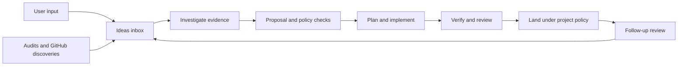

# Team dashboard scope and implementation brief

Status: product scope with an initial implementation delivered on 2026-11-02.
The full autonomous system is not complete. This brief is the shared reference for
building it and comparing independent implementations. It does not authorize
changes to live model permissions, paid routes, or autonomous publishing policies.

## Current implementation

The first build adds Overview, Orchestration, Ideas, a new Agents inspector,
Models, Routines, and historical Usage views while retaining Work, Gateway, and
the configuration editors. These use saved Team records rather than demo metrics.

- Ideas start with a plain-language boss conversation; no project selection or
  intake form is required. The boss gathers specifics through the existing
  conversation and planning flow. Ideas shows conversation proposals, saved AI
  discoveries, and earlier notes, with context ready to discuss with the boss.
- A persistent Boss launcher opens compact messages from any page; Messages
  provides the full saved conversation and activity inbox. Recorded replies,
  run starts/results, open decisions, reviews, and saved scout ideas create
  alerts. Read acknowledgements persist. New events show in-app popup cards;
  opening the app does not replay historical popups. This observes existing
  work and does not create new autonomous scans or notification services.
- Gateway uses service cards, searchable model routes, and fallback paths;
  operational editors and actions remain under Advanced controls.
- Goals link to recorded attempts, model selection reasons, work orders,
  verification output, diagnoses, and model calls. Gateway attempt evidence is
  included only with a recorded session link and matching attempt time.
- Agent inspection resolves target overlays, instructions, skills, model policy,
  budgets, static toolset expansion, and recent role versions used by runs.
- Usage charts show dated input/output/cache counts and recorded cost fields,
  with project/model/role/time filters and underlying tables. Scout and idea calls
  now enter the ledger; cache hits do not create model calls. Legacy receipts are
  visible separately and are not backfilled as invented historical requests.
- Usage highlights the top ten routes/models by reported input plus output
  tokens, using red input and green output on the same horizontal bar. Last
  day/week/month select rolling 1/7/30-day windows. A new model enters when its
  total overtakes the tenth entry; ties sort by name. There is no fixed minimum
  token threshold. Route aliases do not establish the actual responder identity.
- Usage can start a fresh measurement baseline without deleting past calls or
  model-quality evidence. The current period is the default; earlier history is
  accessible through a toggle. A reset affects dashboard accounting, not provider
  invoices or quotas, and is blocked in comparison previews.
- Disabled projects, scout receipts, saved AI proposals, routine definitions,
  durable claims, and graded role/task/model outcomes are inspectable.
- `team/bin/team app --preview --port 8793` creates disposable state for comparison,
  disables execution/configuration actions and message sending, and allows
  temporary idea edits and alert read acknowledgements.

Remaining scope includes guided repository attachment, file/document ingestion,
complete runtime tool and parent/child event capture, historical effective agent
snapshots, automatic idea-to-investigation dispatch, dedicated GitHub research and
post-work audit controls, budget enforcement for those new routines, controlled
routing experiments, and complete cost/provider attribution. An open job is not
proof of a live process; declared tools are not proof of runtime availability.
Unknown prices and missing model identities remain explicitly unknown.

Keep comparison baselines frozen before either implementation starts. This first
build is a contender's implementation, not an equal starting snapshot for another
contender unless both intentionally receive it.

## Goal

Make Team's entire operation visible and understandable: the user's ideas,
AI discoveries, Hermes orchestration, agents, models, tools, skills, work,
verification, follow-up, and spending. The interface must evolve as new agents,
pipelines, routines, and capabilities are added, without hardcoded rosters.

The overview should answer: What is happening? Why? What changed? What needs me?
What did it cost? What is Team proposing next? Each answer must link to evidence.

Team should cheaply read and organize source material, give reasoning models
focused evidence, and use measured outcomes to improve model selection and work.
The desired endpoint includes autonomous investigations and fixes within explicit
project policies, not merely a decorative visualization of agents.

## Starting point and boundaries

Repository HEAD when this brief was prepared:
`1046fc295bf2a7551e5455346fe88b7cf61fe320`.
Record a fresh, shared baseline before starting a model comparison; this hash is
context, not a claim that a comparison worktree has already been created.

Team already has Work, Agents, Gateway, and Usage screens, role manifests,
orchestration, model ranking, opt-in routines, cached existing-checkout scouting,
and summary-based idea generation. See [RUN.md](RUN.md) for current operation.
Existing implementation is a foundation, not proof that this full scope works.
Verify source and runtime evidence before relying on any inherited status claim.

Known gaps from the design inspection:

- No unified history connecting intake, ideas, runs, handoffs, changes, checks,
  follow-ups, and cost.
- Agent views do not fully expose effective per-target runtime configuration.
- Scout and idea usage is not fully attributed to dashboard usage history.
- Disabled targets can be absent from the Work selector, hiding onboarding work.
- Named deployment selection and actual responding provider identity need reliable
  semantics; a route alias alone does not establish actual model identity.
- Continuous audits, GitHub discovery, and evaluated routing improvement are not
  a completed end-to-end system.

All implementation belongs in Team. Preserve existing changes. Do not clone,
clean, stash, move, or modify the user's StudyApp checkout as part of this build.
The intended first attached project is `$HOME/work/StudyApp` (My Prof), using its
existing committed, unpushed, uncommitted, and untracked work within permitted
read scope. Team's project onboarding must preserve that work. Do not resume or
control another Claude/herdr session for this task.

## Required product surfaces

### Overview and projects

- Show active work, queues, blockers, decisions, recent results, spending, and
  proposed next work, with freshness timestamps and links to details.
- Attach an existing local checkout or a GitHub repository through an explicit
  onboarding flow. Distinguish local checkout state from remote GitHub state.
- Show disabled, onboarding, active, and blocked projects. Show scout coverage,
  stale summaries, pending material, checks, and activation prerequisites.
- Separate investigated ideas, verified findings, approved work, and landed work.

### Live orchestration and work

- Show actual Hermes and Team execution: parent/child runs, selected pipeline,
  stages, dependencies, handoffs, queues, retries, fallback events, and blockers.
- Explain which policy selected an agent/model, why a stage ran or was skipped,
  and how verification or failures changed the next action.
- Make graph nodes and timeline entries open their inputs, artifacts, tool calls,
  relevant output, checks, diffs, commits, and usage. Redact credentials.
- Preserve historical configuration and graph versions. Live updates must not
  rewrite the meaning of completed runs.
- Distinguish registered agents, utilities such as Scout, execution modes such
  as Rescue, and code-only verification stages.
- Expose inspectable decision summaries and evidence; do not depend on private
  model reasoning being available.

### Agents and capabilities

- Discover agents dynamically; show proposed, trial, active, planned, disabled,
  and retired states where supported. New agents should appear automatically.
- Inspect purpose, owner/origin, instructions, skills, exact callable tools,
  access scope, permissions, allowed models, fallbacks, gates, and recent runs.
- Distinguish configured, effective for this target, and actually used in a run.
- Show skill/instruction content and provenance, versions, inherited additions,
  configuration diffs, and who changed what and why.
- Separate changes to an agent from project files and commands touched by it.
- Keep specialist roles extensible, including testing, security, UI, backend,
  and bug investigation; do not present planned roles as running agents.

### Models and gateway

- Use named models and deployments in agent policy. Keep tiers as useful labels
  or candidate pools, not a universal ranking of intelligence or suitability.
- Display primary choice, ordered alternatives, triggering conditions, retries,
  cooldowns, limits, and behavior when every permitted route is unavailable.
- Separate provider failover from escalation for task quality. Show every actual
  route transition and its reason, requested model, reported responding model,
  provider, and available evidence. Unknown identity remains unknown.
- Support explicitly allowed frontier Claude subscription routes for suitable
  roles. Catalog presence does not prove availability. Do not silently introduce
  paid API fallback or change live permissions.
- Show availability, quota when reported, context/tool/vision/structured-output
  capability, and whether each claim is declared or verified.
- Apply configuration changes to the next appropriate attempt/session and show
  the version in use; preserve Hermes conversation prompt caching.

### Capability evidence and improvement

- Compare models by role, task category, and project, including within a tier.
- Separate task quality from provider availability, throttling, and transport
  failure. A provider outage is not evidence of poor reasoning.
- Show sample sizes, comparable baselines, evaluation provenance, and recency.
  Untested capabilities stay unevaluated; avoid unsupported composite scores.
- Track relevant outcomes: summary citation accuracy and coverage, implementation
  checks/regressions, review misses/false blocks, planning downstream outcomes.
- Support observe → compare candidates → evaluate proposed policy → apply under
  policy → monitor → revert. Keep the change and rollback history visible.

### Ideas and efficient intake

- Provide one intake surface for user ideas, text, documents, links, repository
  references, and questions about evolving another part of the system.
- Preserve source, intent, affected project, evidence, freshness, dependencies,
  duplicate relationships, priority, and status.
- Put user ideas and AI discoveries into a shared lifecycle while retaining
  their origins. Allow useful ideas to remain parked rather than becoming work.
- Cache and incrementally update source summaries. Use inexpensive extraction
  where suitable and concise evidence packets for reasoning models.
- Permit targeted source retrieval when summaries are insufficient. Never treat
  a summary-only proposal as a verified bug or force conclusions from stale data.
- Show the evidence used, missing context, processing status, and attributed cost.

### Continuous improvement and routines

- Show post-work review, scheduled repository audits, committed-code bug checks,
  GitHub research, and capability evaluation as inspectable routines.
- Each routine exposes trigger/schedule, timezone, scope, permissions, budgets,
  last result, next run, active run, findings, and stop conditions.
- Support investigating completed/committed work, reproducing a finding, and
  creating a tested fix through the normal pipeline within configured authority.
- GitHub discoveries include provenance, relevance, compatibility, maintenance
  evidence, and an adoption proposal before changing dependencies or execution.
- Make controls for read/investigate, edit/test, and land/publish distinct. Preserve
  existing gates; changing a schedule must not implicitly widen authority.
- Prevent duplicate dispatch and recursive idea/review loops from consuming an
  unlimited budget. Display paused, exhausted, failed, and skipped runs clearly.

### Usage and visual evidence

- Line graphs for spending over time and input/output tokens over time, with
  cached input separately represented according to provider semantics.
- Filter/group by time window, model, provider, project, agent, routine, and run.
- Include scout, reasoning, retries, failures, fallbacks, and evaluation calls.
- Show cost per verified outcome, task latency, fallback/failure trends, budget
  consumption, and labeled forecasts when enough data exists.
- Separate metered API charges, estimates, and subscription usage. Missing price
  or quota is unknown, not zero. Avoid double-counting cached tokens or retries.
- Make aggregate totals drill down to the contributing records. Show units,
  timezone, data freshness, and gaps. Provide readable tables alongside charts.

## Backend work required

Finalize concrete contracts against existing code before implementing each slice.
The following are required concepts, not mandated new databases or modules:

| Contract | Minimum information |
|---|---|
| Run and event history | Stable IDs, project/goal/part/stage, parent run, event time, state transition, trigger, reason, configuration version, artifact references |
| Agent snapshot | Role, effective instructions/tools/skills/access, target overlay, model policy, provenance, version |
| Model attempt | Requested route, deployment/provider evidence, actual reported identity, fallback/escalation cause, timing, outcome |
| Usage record | Attempt linkage, token categories, source of counts, cost basis/currency, measured versus estimated versus unknown |
| Idea and finding | Origin, source versions, evidence, verification state, related work, disposition and lifecycle history |
| Routine run | Schedule/trigger, scope, policy, budget, durable dispatch identity, result and next-run state |
| Evaluation | Task category, candidate/version, comparable baseline, samples, grades, infrastructure exclusions, policy change linkage |

Prefer extending existing ledger, roles, scout, catalog, and routine contracts.
Account for concurrent workers, restart recovery, duplicate events, historical
records without new fields, and project/profile isolation. Keep secrets out of
UI payloads and logs. Select polling or streaming based on existing architecture;
the user-facing requirement is fresh, inspectable state with visible disconnects.

## Delivery sequence and acceptance

1. **Trace one complete path.** Connect an idea to a run, selected agents/models,
   produced changes, verification, and attributed usage. Accept when a user can
   navigate the chain both ways using real records and missing data is explicit.
2. **Build inspection and overview.** Add dynamic agent inspection, orchestration,
   project/onboarding visibility, and model/fallback details. Accept when a newly
   registered role appears without a frontend roster change and historical runs
   retain their own configuration.
3. **Complete intake and usage.** Add evidence intake and historical charts. Accept
   when scout/reasoning usage is included and chart totals reconcile to records,
   including failed attempts, cached-token semantics, and unknown costs.
4. **Expose recurring improvement.** Wire supported routines and findings into the
   same pipeline. Accept when a scheduled run is visible, does not duplicate on
   restart, respects its authority/budget, and links findings to follow-up work.
5. **Evaluate routing improvements.** Add task-specific comparisons and policy
   experiments. Accept when changes cite comparable evidence, distinguish quality
   from outages, preserve permissions, and have an inspectable rollback path.

Across all phases: readable navigation, keyboard access, text/table alternatives
to graphs, responsive layouts, clear loading/empty/error/stale states, meaningful
filters, and no fabricated live activity. Mockup layout is guidance, not a fixed
pixel specification. A visually complete mockup is not backend completion.

## Independent model comparison

The first comparison is a dashboard implementation comparison, not certification
of the entire autonomous system. Give both models this brief, the same source
snapshot, the same design references, and the same available backend contracts.

- Use separate worktrees/branches from one recorded commit, preserving the main
  checkout and existing work. Include this brief in both starting snapshots.
- Verify the intended Fable 5.1 route before running it; a configured alias does
  not prove model availability or identity. Record the actual route evidence.
- Agree identical execution budgets and implementation scope before dispatch.
  Do not invent limits or assume subscription usage has an API dollar price.
- Default comparison scope: overview, orchestration, agent inspector, ideas
  pipeline, model/fallback inspection, and usage charts; the minimum backend
  additions needed for these views belong in scope for both contenders.
- Use real data where supported. A shared, explicitly labeled demo fixture may
  demonstrate missing states, but cannot count as live integration. Keep demo
  state isolated from production and provide an integration-gap list.
- Both deliver runnable code, startup instructions, screenshots, changed-file
  summary, validation results, and remaining backend gaps. Neither implementation
  should consume the other's work before comparison.
- Compare task completion, visual clarity, ease of tracing work, correctness of
  data and uncertainty, integration quality, maintainability, accessibility, and
  measured implementation usage/time where available. Do not preassign a winner.
- Do not merge, deploy, widen authority, or enable paid routes merely to conduct
  the comparison. The user chooses what to adopt after reviewing both results.

## Validation and references

Read applicable AGENTS.md files before changing code. Follow existing Team
conventions and use `team/bin/team-check` for Team validation; never bare pytest.
Add behavior tests for event/usage attribution, effective configuration, fallback
reporting, and routine dispatch where changed. Use isolated test state. Visually
exercise the implemented screens and check important navigation and filters.

Code entry points to inspect: `team/app/`, `team/roles.py`, `team/profiles.py`,
`team/lead.py`, `team/ledger.py`, `team/usage.py`, `team/model_tracking.py`,
`team/catalog.py`, `team/models.py`, `team/scout.py`, `team/routines.py`, and
`team/review/`. Follow references rather than assuming their contracts are final.

Design artifacts are currently local at
`$HOME/state/team/design-drafts/dashboard-concepts/`:

- `01-project-overview.png` and `.html`
- `02-agent-map.png` and `.html`
- `03-work-flow.png` and `.html`
- `04-all-agents.png` and `.html`
- `05-agent-inspector.png` and `.html`
- `06-model-routing.png` and `.html`
- Mermaid `.mmd` sources and `team-dashboard-concepts.zip`

These are illustrative designs, not screenshots of implemented functionality.
Provide identical copies to comparison workspaces if the local artifacts are not
accessible there. This brief remains usable without the images.

## Reusable implementation request

> Build the Team dashboard using `team/docs/DASHBOARD-SCOPE.md` as the scope and
> acceptance reference. Read the applicable repository instructions first. Inspect
> the existing backend and preserve current work. Start with the complete trace
> from idea through execution, verification, and usage, then implement the agreed
> comparison scope. Use real data where available and explicitly label demo or
> unavailable states. Do not modify StudyApp, change live routing permissions, or
> enable paid fallbacks. Report what works, what was validated, and what remains.
